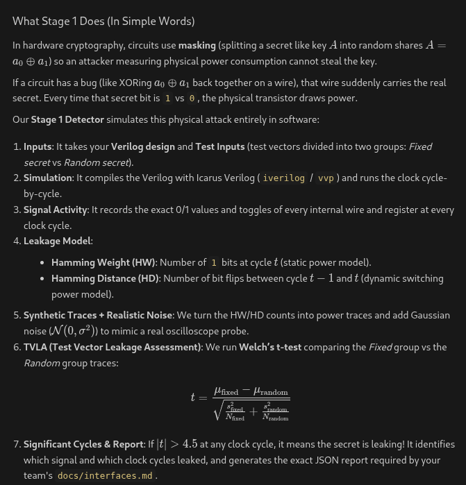
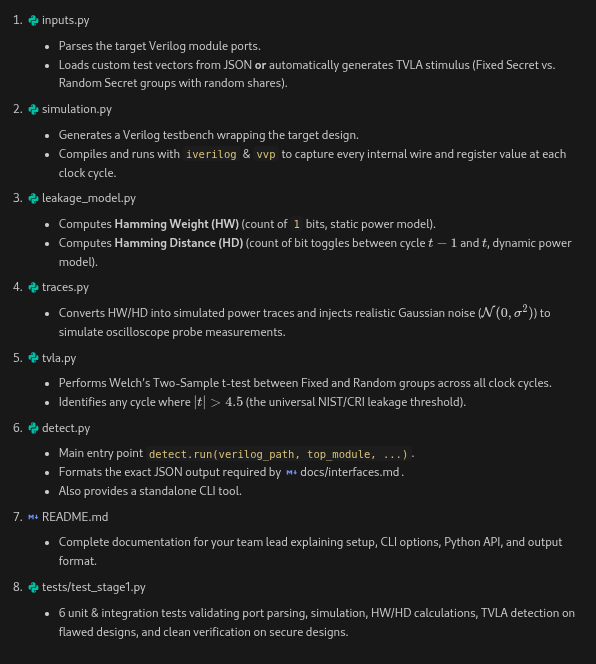

# Stage 1: Detect (Duo 1) - Aashish & Naitik 

Side-channel vulnerability detection for masked hardware circuits using RTL simulation, power leakage models, and Test Vector Leakage Assessment (TVLA).


# Stage 1 Part Explanation of each file




# Detailed explanation of what each file is doing 




## Workflow Architecture

```
[Verilog Design] + [Test Inputs]
          │
          ▼
[Icarus Verilog Simulation (iverilog + vvp)]
          │
          ▼
[Cycle-by-Cycle Signal Activity Extraction]
          │
          ▼
[Leakage Model: Hamming Weight (HW) / Hamming Distance (HD)]
          │
          ▼
[Synthetic Power Traces + Realistic Gaussian Noise N(0, σ²)]
          │
          ▼
[Welch's t-test (TVLA: Fixed vs Random Groups)]
          │
          ▼
[Significant Cycles Detection (|t| > 4.5)]
          │
          ▼
[Leakage Report (JSON)]
```

---

## Installation & Requirements

### System Dependencies
- Python 3.10+
- Icarus Verilog:
  ```bash
  sudo apt-get install iverilog
  ```

### Python Dependencies
Installed via `requirements.txt`:
```bash
pip install numpy scipy
```

---

## How to Run

### 1. Command Line Interface (CLI)
Run directly with default auto-generated TVLA vectors:
```bash
python3 -m stage1_detect.detect designs/flawed_and.v --top flawed_and
```

With custom options (trace count, model, noise, output file):
```bash
python3 -m stage1_detect.detect designs/flawed_and.v \
    --top flawed_and \
    --traces 1000 \
    --model hamming_weight \
    --noise-std 0.5 \
    --threshold 4.5 \
    --out leakage_report.json
```

Or using an explicit test inputs file:
```bash
python3 -m stage1_detect.detect designs/flawed_and.v \
    --top flawed_and \
    --test-inputs test_vectors.json
```

### 2. Python API
```python
from stage1_detect import detect

# Run with auto-generated TVLA vectors
report = detect.run("designs/flawed_and.v", "flawed_and")
print(report)

# Run with custom parameters or test input file
report = detect.run(
    verilog_path="designs/flawed_and.v",
    top_module="flawed_and",
    test_inputs="path/to/inputs.json",  # optional
    num_traces=1000,
    leakage_model="hamming_weight",     # or "hamming_distance"
    threshold=4.5,
)
```

---

## Output Format (`docs/interfaces.md`)

```json
{
  "design": "designs/flawed_and.v",
  "top_module": "flawed_and",
  "leakage_model": "hamming_weight",
  "num_traces": 1000,
  "leaky": true,
  "findings": [
    {
      "signal": "a",
      "cycles": [0, 1, 2, 3],
      "t_statistic": 23.45,
      "threshold": 4.5
    },
    {
      "signal": "y",
      "cycles": [3],
      "t_statistic": 11.2,
      "threshold": 4.5
    }
  ]
}
```

- `leaky`: `true` if any signal exceeds the threshold (`|t| > 4.5`), `false` otherwise.
- `findings`: List of leaky signals with their affected clock cycles and max $|t|$-statistic. Empty if secure (`leaky == false`).

---

## Internal Modules

- **`inputs.py`**: Handles parsing Verilog ports, loading custom input files, and auto-generating standard Fixed vs Random TVLA test vectors.
- **`simulation.py`**: Dynamically creates a Verilog testbench, runs `iverilog` & `vvp`, and captures cycle-by-cycle signal values.
- **`leakage_model.py`**: Computes Hamming Weight (HW) and Hamming Distance (HD) on monitored signals.
- **`traces.py`**: Adds realistic Gaussian measurement noise to construct physical-like power traces.
- **`tvla.py`**: Implements Welch's two-sample t-test between Fixed and Random groups.
- **`detect.py`**: Orchestrates the entire detection flow and generates the report.
